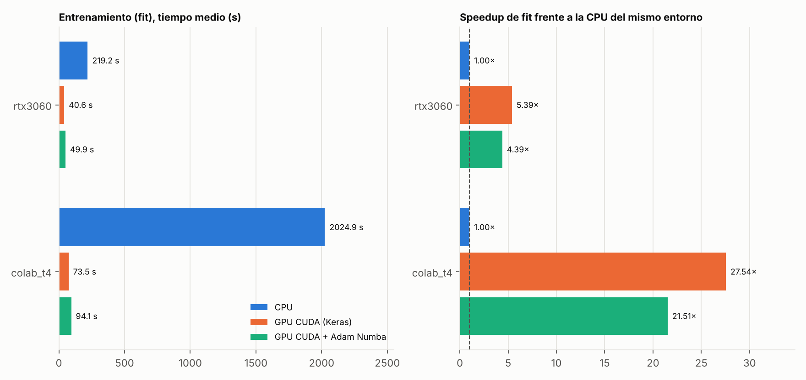

# Comparación entre entornos

Cada entorno se compara primero consigo mismo (CPU y GPU en la misma máquina). Comparar una GPU con otra mide hardware distinto con el mismo código y los mismos datos; no se calcula un speedup CUDA mezclando la CPU de un equipo con la GPU de otro.

| Entorno | CPU | GPU | TensorFlow |
|---|---:|---:|---:|
| rtx3060 | 11th Gen Intel(R) Core(TM) i7-11800H @ 2.30GHz (16 hilos) | NVIDIA GeForce RTX 3060 Laptop GPU (6,144 MiB) | 2.21.0 |
| colab_t4 | Intel(R) Xeon(R) CPU @ 2.00GHz (2 hilos) | Tesla T4 (15,360 MiB) | 2.21.0 |

| Entorno | Versión | n | fit (s) | Época 2..N (s) | Total del comando (s) | Speedup fit vs CPU propia | Speedup total vs CPU propia | Exactitud de prueba |
|---|---:|---:|---:|---:|---:|---:|---:|---:|
| rtx3060 | CPU | 5 | 219.19 ± 5.45 | 10.916 | 225.04 | 1.00× | 1.00× | 82.61 % |
| rtx3060 | GPU CUDA (Keras) | 5 | 40.65 ± 0.22 | 1.871 | 45.39 | 5.39× | 4.96× | 80.88 % |
| rtx3060 | GPU CUDA + Adam Numba | 5 | 49.90 ± 0.43 | 2.358 | 55.69 | 4.39× | 4.04× | 79.00 % |
| colab_t4 | CPU | 3 | 2,024.91 ± 116.44 | 100.811 | 2,049.91 | 1.00× | 1.00× | 79.85 % |
| colab_t4 | GPU CUDA (Keras) | 5 | 73.52 ± 3.10 | 3.300 | 85.67 | 27.54× | 23.93× | 81.61 % |
| colab_t4 | GPU CUDA + Adam Numba | 5 | 94.13 ± 1.11 | 4.391 | 107.51 | 21.51× | 19.07× | 79.62 % |

Tiempo de fit entre las dos GPU (mismo código, mismos datos; compara hardware, no es un speedup CUDA):

| Versión | fit rtx3060 | fit colab_t4 | colab_t4 / rtx3060 |
|---|---:|---:|---:|
| GPU CUDA (Keras) | 40.65 s | 73.52 s | 1.81× |
| GPU CUDA + Adam Numba | 49.90 s | 94.13 s | 1.89× |

