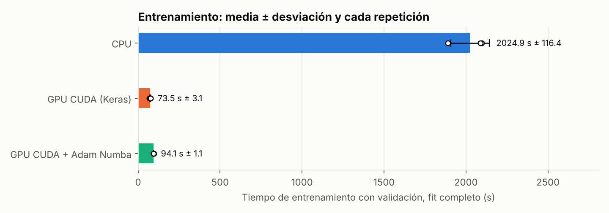
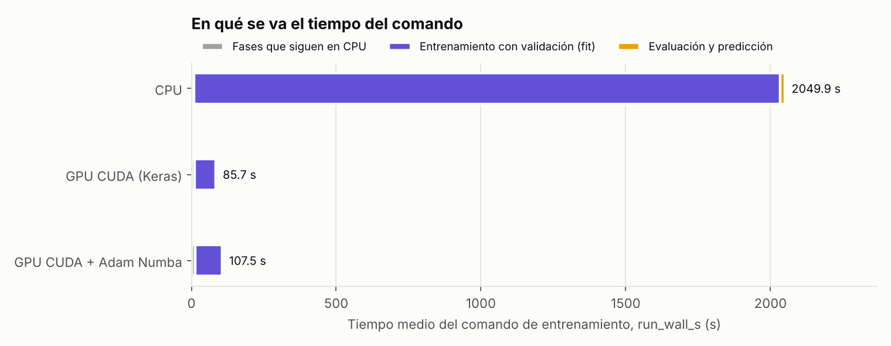
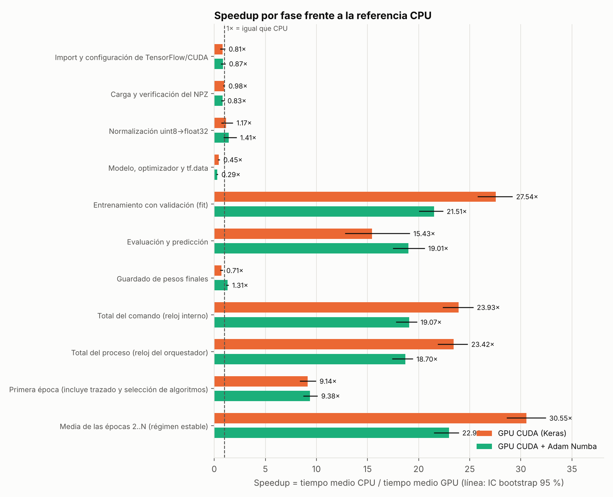
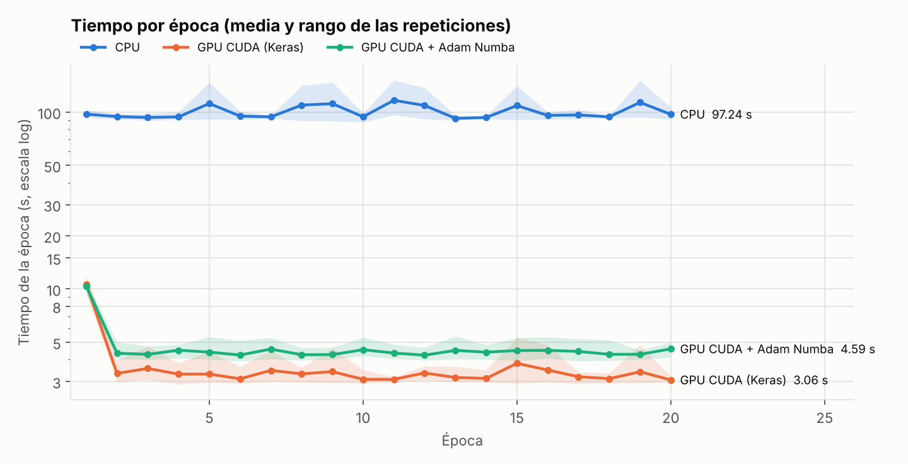
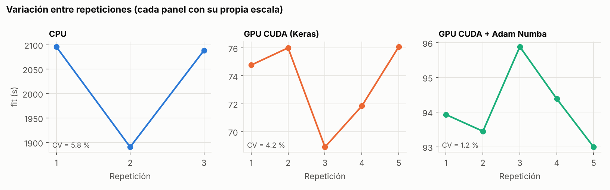
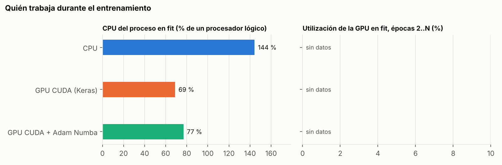

# Resultados de la parte 3 · colab_t4

## Entorno y método

| Elemento | Valor |
|---|---:|
| CPU | Intel(R) Xeon(R) CPU @ 2.00GHz · 1 núcleos / 2 hilos |
| RAM | 12.7 GiB |
| GPU | Tesla T4 · driver 580.82.07 · 15,360 MiB |
| Sistema / Python | Linux-6.6.159+-x86_64-with-glibc2.39 · 3.13.16 |
| TensorFlow | 2.21.0 |
| Commit | None |
| Repeticiones medidas | CPU: 3, GPU CUDA (Keras): 5, GPU CUDA + Adam Numba: 5 |
| Calentamiento | smoke (descartado, una corrida por configuración) |
| Orden | preparación primero; después calentamiento por configuración y repeticiones intercaladas con orden rotado (la repetición r desplaza la lista r lugares) |
| Enfriamiento entre corridas | 10.0 s |
| Hilos intra-op de TensorFlow | 2 |
| Carga de trabajo | 17,400 imágenes 64×64 RGB · CNN base de 1,145,693 parámetros · Adam 0.001 · lote 64 · 20 épocas · float32 estricto (sin TF32) |
| Misma carga en todas las corridas | sí |

Cada valor es media ± desviación estándar muestral de las repeticiones medidas. El speedup es la media de la referencia CPU entre la media de la versión con GPU; entre corchetes, intervalo bootstrap del 95 %.

## Tiempos por fase (s)

| Fase | Se ejecuta en | CPU | GPU CUDA (Keras) | GPU CUDA + Adam Numba |
|---|---:|---:|---:|---:|
| Import y configuración de TensorFlow/CUDA | CPU | 3.592 ± 0.741 | 4.425 ± 0.829 | 4.143 ± 0.578 |
| Carga y verificación del NPZ | CPU | 2.643 ± 0.066 | 2.708 ± 0.148 | 3.186 ± 0.399 |
| Normalización uint8→float32 | CPU | 0.713 ± 0.341 | 0.612 ± 0.141 | 0.505 ± 0.027 |
| Modelo, optimizador y tf.data | CPU + contexto | 1.111 ± 0.100 | 2.459 ± 0.377 | 3.834 ± 0.602 |
| Entrenamiento con validación (fit) | dispositivo | 2,024.913 ± 116.442 | 73.520 ± 3.103 | 94.128 ± 1.112 |
| Evaluación y predicción | dispositivo | 16.029 ± 0.905 | 1.039 ± 0.253 | 0.843 ± 0.069 |
| Guardado de pesos finales | CPU | 0.047 ± 0.002 | 0.066 ± 0.011 | 0.036 ± 0.002 |
| Total del comando (reloj interno) | total | 2,049.906 ± 117.236 | 85.667 ± 3.565 | 107.515 ± 1.073 |
| Total del proceso (reloj del orquestador) | total | 2,051.598 ± 117.152 | 87.612 ± 3.696 | 109.734 ± 0.977 |

Las fases no se suman otra vez al total: `run_wall_s` ya incluye todas y además el monitor y tareas entre fases. `process_wall_s` es el proceso completo visto desde fuera (incluye arrancar Python e importar módulos).

## Tiempo por época (s)

Separado del entrenamiento completo, como pide el acuerdo del equipo.

| Medición | CPU | GPU CUDA (Keras) | GPU CUDA + Adam Numba |
|---|---:|---:|---:|
| Primera época (incluye trazado y selección de algoritmos) | 97.422 ± 4.955 | 10.662 ± 0.908 | 10.389 ± 0.749 |
| Media de las épocas 2..N (régimen estable) | 100.811 ± 5.489 | 3.300 ± 0.162 | 4.391 ± 0.057 |

## Speedup por fase (CPU / GPU)

| Fase | GPU CUDA (Keras) | GPU CUDA + Adam Numba |
|---|---:|---:|
| Import y configuración de TensorFlow/CUDA | 0.81× [0.64–1.04] | 0.87× [0.71–1.07] |
| Carga y verificación del NPZ | 0.98× [0.93–1.02] | 0.83× [0.75–0.92] |
| Normalización uint8→float32 | 1.17× [0.74–1.81] | 1.41× [0.96–2.16] |
| Modelo, optimizador y tf.data | 0.45× [0.39–0.52] | 0.29× [0.25–0.33] |
| Entrenamiento con validación (fit) | 27.54× [25.81–29.17] | 21.51× [20.11–22.37] |
| Evaluación y predicción | 15.43× [12.85–19.11] | 19.01× [17.54–20.56] |
| Guardado de pesos finales | 0.71× [0.62–0.81] | 1.31× [1.25–1.38] |
| Total del comando (reloj interno) | 23.93× [22.42–25.33] | 19.07× [17.83–19.81] |
| Total del proceso (reloj del orquestador) | 23.42× [21.95–24.78] | 18.70× [17.48–19.41] |
| Primera época (incluye trazado y selección de algoritmos) | 9.14× [8.44–9.93] | 9.38× [8.76–10.10] |
| Media de las épocas 2..N (régimen estable) | 30.55× [28.66–32.42] | 22.96× [21.56–23.90] |

Un valor menor que 1 indica que esa fase tarda más con la versión GPU (por ejemplo, crear el contexto CUDA dentro de la construcción del modelo).

### Ley de Amdahl

| Versión | p (fracción acelerable en CPU) | Speedup de fit + evaluación | Total previsto por Amdahl | Total medido | Límite si fit fuese instantáneo | Fases no aceleradas (s), CPU → GPU |
|---|---:|---:|---:|---:|---:|---:|
| GPU CUDA (Keras) | 99.6 % | 27.37× | 24.54× | 23.93× | 228.7× | 8.96 → 11.11 |
| GPU CUDA + Adam Numba | 99.6 % | 21.49× | 19.72× | 19.07× | 228.7× | 8.96 → 12.54 |

p es la fracción de `run_wall_s` de la referencia CPU que pasa al dispositivo (fit y evaluación). El total medido queda por debajo del previsto cuando las fases que siguen en CPU también crecen con la GPU (inicialización de CUDA y del contexto).

## Transferencias host → GPU

| Versión | Copiado durante fit | Tasa efectiva en fit | Copiado en evaluación |
|---|---:|---:|---:|
| GPU CUDA (Keras) | 14.54 GB | 0.198 GB/s | 0.385 GB |
| GPU CUDA + Adam Numba | 14.54 GB | 0.154 GB/s | 0.385 GB |

Los bytes salen del tamaño real de los lotes que Keras copia en cada época. El tiempo de copia está dentro de fit y de la evaluación y no se suma de nuevo al total.

## Uso de recursos durante fit

| Versión | CPU del proceso | Media por procesador lógico | Utilización SM (épocas 2..N) | Memoria GPU (máx.) | Potencia GPU | Temperatura máx. |
|---|---:|---:|---:|---:|---:|---:|
| CPU | 144 % (≈1.4 hilos) | 92.6 % | — | — | — | — |
| GPU CUDA (Keras) | 69 % (≈0.7 hilos) | 52.8 % | — | — | — | — |
| GPU CUDA + Adam Numba | 77 % (≈0.8 hilos) | 57.0 % | — | — | — | — |

CPU del proceso: 100 % equivale a un procesador lógico. La memoria GPU de nvidia-smi incluye el escritorio y otros procesos; en la versión CPU muestra solo ese consumo de fondo.

## Calidad del modelo

| Versión | Exactitud de prueba | Exactitud de validación | Valores distintos entre repeticiones | Predicciones iguales a la CPU rep. 1 |
|---|---:|---:|---:|---:|
| CPU | 79.85 ± 0.00 % | 72.99 ± 0.00 % | 1 | — |
| GPU CUDA (Keras) | 81.61 ± 0.00 % | 77.93 ± 0.00 % | 1 | — |
| GPU CUDA + Adam Numba | 79.62 ± 0.00 % | 72.84 ± 0.00 % | 1 | — |

Un solo valor distinto confirma que cada versión es reproducible en el mismo dispositivo (`enable_op_determinism`). CPU y GPU suman en distinto orden, así que entre dispositivos se esperan diferencias pequeñas de redondeo y no idénticas.

## Gráficos

Corridas de calentamiento descartadas: train/cpu/warmup01, train/gpu_keras/warmup01, train/gpu_numba/warmup01.
