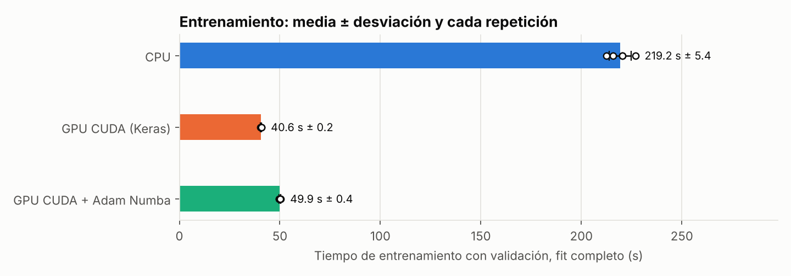
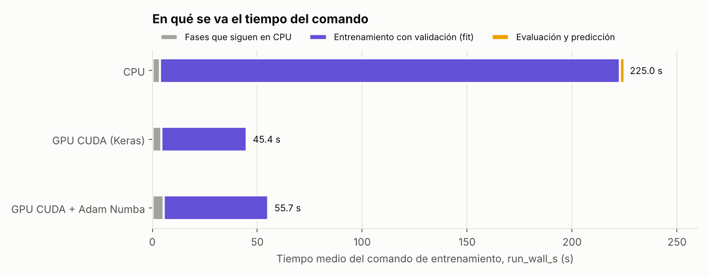
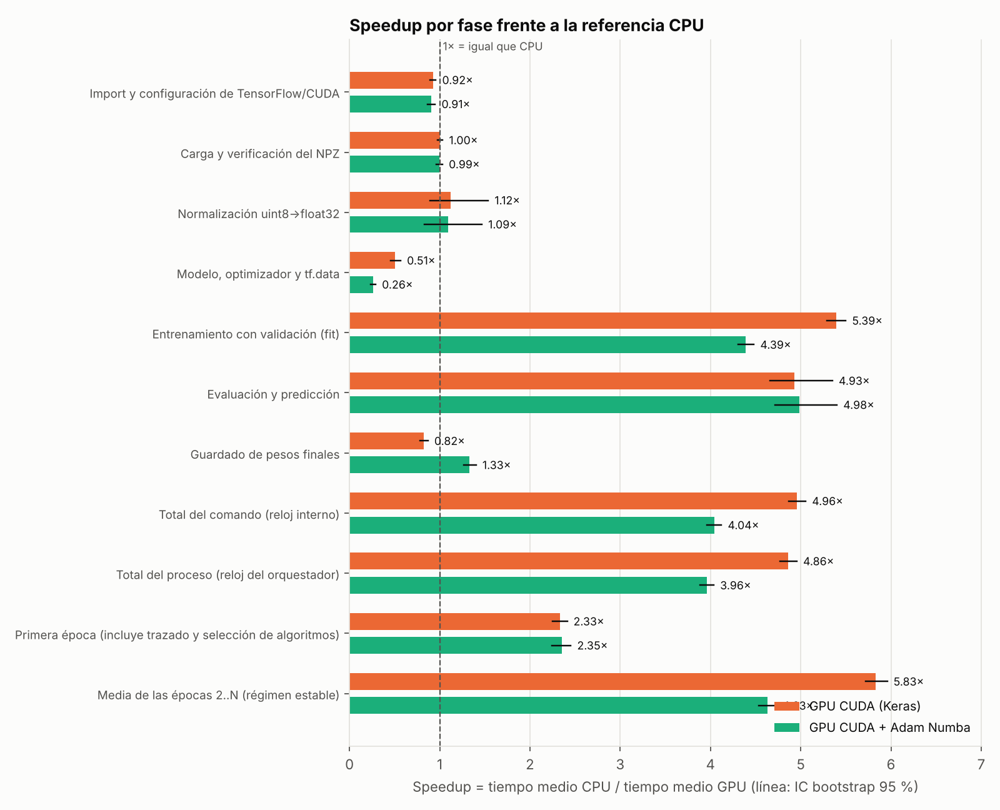
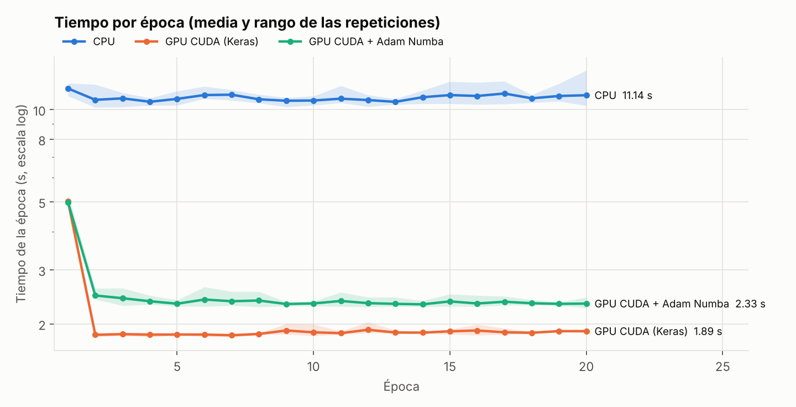
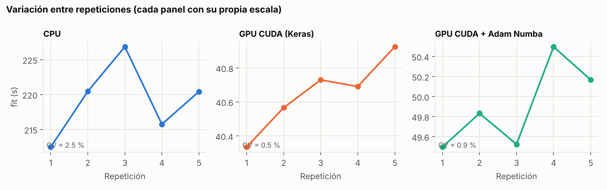
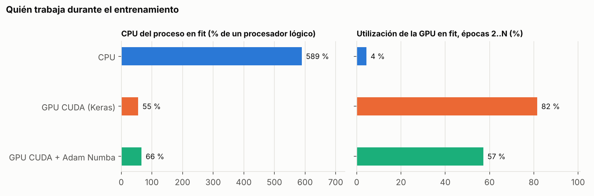
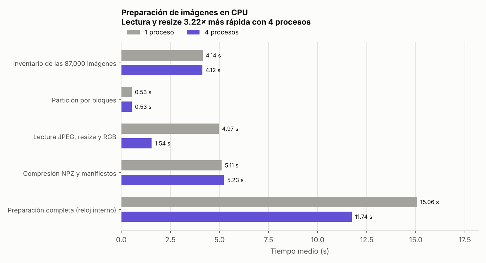

# Resultados de la parte 3 · rtx3060

## Entorno y método

| Elemento | Valor |
|---|---:|
| CPU | 11th Gen Intel(R) Core(TM) i7-11800H @ 2.30GHz · 8 núcleos / 16 hilos |
| RAM | 15.4 GiB |
| GPU | NVIDIA GeForce RTX 3060 Laptop GPU · driver 550.163.01 · 6,144 MiB |
| Sistema / Python | Linux-6.8.0-45-generic-x86_64-with-glibc2.39 · 3.12.3 |
| TensorFlow | 2.21.0 |
| Commit | 3928a4ce4d919ab1c8f9978aab0daa62fdb59f17 |
| Repeticiones medidas | CPU: 5, GPU CUDA (Keras): 5, GPU CUDA + Adam Numba: 5 |
| Calentamiento | smoke (descartado, una corrida por configuración) |
| Orden | preparación primero; después calentamiento por configuración y repeticiones intercaladas con orden rotado (la repetición r desplaza la lista r lugares) |
| Enfriamiento entre corridas | 30.0 s, y GPU ≤ 60.0 °C |
| Hilos intra-op de TensorFlow | 8 |
| Carga de trabajo | 17,400 imágenes 64×64 RGB · CNN base de 1,145,693 parámetros · Adam 0.001 · lote 64 · 20 épocas · float32 estricto (sin TF32) |
| Misma carga en todas las corridas | sí |

Cada valor es media ± desviación estándar muestral de las repeticiones medidas. El speedup es la media de la referencia CPU entre la media de la versión con GPU; entre corchetes, intervalo bootstrap del 95 %.

## Tiempos por fase (s)

| Fase | Se ejecuta en | CPU | GPU CUDA (Keras) | GPU CUDA + Adam Numba |
|---|---:|---:|---:|---:|
| Import y configuración de TensorFlow/CUDA | CPU | 1.416 ± 0.055 | 1.532 ± 0.039 | 1.561 ± 0.075 |
| Carga y verificación del NPZ | CPU | 1.258 ± 0.020 | 1.253 ± 0.042 | 1.264 ± 0.052 |
| Normalización uint8→float32 | CPU | 0.224 ± 0.082 | 0.200 ± 0.021 | 0.206 ± 0.039 |
| Modelo, optimizador y tf.data | CPU + contexto | 0.540 ± 0.070 | 1.070 ± 0.068 | 2.073 ± 0.081 |
| Entrenamiento con validación (fit) | dispositivo | 219.192 ± 5.447 | 40.649 ± 0.218 | 49.904 ± 0.429 |
| Evaluación y predicción | dispositivo | 2.174 ± 0.199 | 0.441 ± 0.009 | 0.436 ± 0.007 |
| Guardado de pesos finales | CPU | 0.026 ± 0.002 | 0.032 ± 0.001 | 0.020 ± 0.000 |
| Total del comando (reloj interno) | total | 225.044 ± 5.497 | 45.391 ± 0.240 | 55.686 ± 0.349 |
| Total del proceso (reloj del orquestador) | total | 226.000 ± 5.478 | 46.469 ± 0.226 | 57.053 ± 0.298 |

Las fases no se suman otra vez al total: `run_wall_s` ya incluye todas y además el monitor y tareas entre fases. `process_wall_s` es el proceso completo visto desde fuera (incluye arrancar Python e importar módulos).

## Tiempo por época (s)

Separado del entrenamiento completo, como pide el acuerdo del equipo.

| Medición | CPU | GPU CUDA (Keras) | GPU CUDA + Adam Numba |
|---|---:|---:|---:|
| Primera época (incluye trazado y selección de algoritmos) | 11.720 ± 0.504 | 5.024 ± 0.076 | 4.982 ± 0.191 |
| Media de las épocas 2..N (régimen estable) | 10.916 ± 0.286 | 1.871 ± 0.013 | 2.358 ± 0.017 |

## Speedup por fase (CPU / GPU)

| Fase | GPU CUDA (Keras) | GPU CUDA + Adam Numba |
|---|---:|---:|
| Import y configuración de TensorFlow/CUDA | 0.92× [0.89–0.96] | 0.91× [0.86–0.95] |
| Carga y verificación del NPZ | 1.00× [0.98–1.03] | 0.99× [0.96–1.03] |
| Normalización uint8→float32 | 1.12× [0.89–1.54] | 1.09× [0.83–1.47] |
| Modelo, optimizador y tf.data | 0.51× [0.45–0.57] | 0.26× [0.24–0.29] |
| Entrenamiento con validación (fit) | 5.39× [5.29–5.50] | 4.39× [4.30–4.48] |
| Evaluación y predicción | 4.93× [4.66–5.35] | 4.98× [4.72–5.40] |
| Guardado de pesos finales | 0.82× [0.78–0.87] | 1.33× [1.26–1.40] |
| Total del comando (reloj interno) | 4.96× [4.87–5.06] | 4.04× [3.96–4.12] |
| Total del proceso (reloj del orquestador) | 4.86× [4.77–4.96] | 3.96× [3.89–4.04] |
| Primera época (incluye trazado y selección de algoritmos) | 2.33× [2.25–2.41] | 2.35× [2.25–2.45] |
| Media de las épocas 2..N (régimen estable) | 5.83× [5.72–5.96] | 4.63× [4.53–4.73] |

Un valor menor que 1 indica que esa fase tarda más con la versión GPU (por ejemplo, crear el contexto CUDA dentro de la construcción del modelo).

### Ley de Amdahl

| Versión | p (fracción acelerable en CPU) | Speedup de fit + evaluación | Total previsto por Amdahl | Total medido | Límite si fit fuese instantáneo | Fases no aceleradas (s), CPU → GPU |
|---|---:|---:|---:|---:|---:|---:|
| GPU CUDA (Keras) | 98.4 % | 5.39× | 5.03× | 4.96× | 61.2× | 3.68 → 4.30 |
| GPU CUDA + Adam Numba | 98.4 % | 4.40× | 4.17× | 4.04× | 61.2× | 3.68 → 5.35 |

p es la fracción de `run_wall_s` de la referencia CPU que pasa al dispositivo (fit y evaluación). El total medido queda por debajo del previsto cuando las fases que siguen en CPU también crecen con la GPU (inicialización de CUDA y del contexto).

## Transferencias host → GPU

| Versión | Copiado durante fit | Tasa efectiva en fit | Copiado en evaluación |
|---|---:|---:|---:|
| GPU CUDA (Keras) | 14.54 GB | 0.358 GB/s | 0.385 GB |
| GPU CUDA + Adam Numba | 14.54 GB | 0.291 GB/s | 0.385 GB |

Los bytes salen del tamaño real de los lotes que Keras copia en cada época. El tiempo de copia está dentro de fit y de la evaluación y no se suma de nuevo al total.

## Uso de recursos durante fit

| Versión | CPU del proceso | Media por procesador lógico | Utilización SM (épocas 2..N) | Memoria GPU (máx.) | Potencia GPU | Temperatura máx. |
|---|---:|---:|---:|---:|---:|---:|
| CPU | 589 % (≈5.9 hilos) | 40.9 % | 4 % | 256 MiB | 15.1 W | 60 °C |
| GPU CUDA (Keras) | 55 % (≈0.6 hilos) | 5.6 % | 82 % | 640 MiB | 78.2 W | 84 °C |
| GPU CUDA + Adam Numba | 66 % (≈0.7 hilos) | 7.2 % | 57 % | 700 MiB | 75.2 W | 85 °C |

CPU del proceso: 100 % equivale a un procesador lógico. La memoria GPU de nvidia-smi incluye el escritorio y otros procesos; en la versión CPU muestra solo ese consumo de fondo.

## Calidad del modelo

| Versión | Exactitud de prueba | Exactitud de validación | Valores distintos entre repeticiones | Predicciones iguales a la CPU rep. 1 |
|---|---:|---:|---:|---:|
| CPU | 82.61 ± 0.00 % | 74.48 ± 0.00 % | 1 | — |
| GPU CUDA (Keras) | 80.88 ± 0.00 % | 74.67 ± 0.00 % | 1 | — |
| GPU CUDA + Adam Numba | 79.00 ± 0.00 % | 71.88 ± 0.00 % | 1 | — |

Un solo valor distinto confirma que cada versión es reproducible en el mismo dispositivo (`enable_op_determinism`). CPU y GPU suman en distinto orden, así que entre dispositivos se esperan diferencias pequeñas de redondeo y no idénticas.

## Preparación de imágenes en CPU (multiproceso)

| Fase | 1 proceso | 4 procesos | Speedup 4 vs 1 |
|---|---:|---:|---:|
| Inventario de las 87,000 imágenes | 4.142 ± 0.060 | 4.124 ± 0.091 | 1.00× [0.98–1.02] |
| Partición por bloques | 0.529 ± 0.011 | 0.532 ± 0.011 | 0.99× [0.97–1.02] |
| Lectura JPEG, resize y RGB | 4.970 ± 0.112 | 1.545 ± 0.059 | 3.22× [3.11–3.33] · E = 80 % |
| Compresión NPZ y manifiestos | 5.110 ± 0.065 | 5.226 ± 0.158 | 0.98× [0.95–1.00] |
| Preparación completa (reloj interno) | 15.060 ± 0.209 | 11.740 ± 0.160 | 1.28× [1.26–1.30] · E = 32 % |
| Preparación, proceso completo | 15.400 ± 0.213 | 12.086 ± 0.166 | 1.27× [1.25–1.29] · E = 32 % |
| CPU del árbol de procesos durante la lectura | 94 % | 55 % |  |
| Procesadores lógicos > 50 % (media) | 1.0 | 2.4 |  |

Todas las repeticiones reproducen exactamente los arreglos usados para entrenar: sí.
E es la eficiencia paralela (speedup entre el aumento de procesos); solo se muestra donde hay trabajo repartido entre procesos. Inventario, partición y exportación (compresión del NPZ) se ejecutan en el proceso principal en ambos modos, por eso no se aceleran.

### Flujo completo: preparación + entrenamiento

| Flujo | Tiempo (s) | Speedup |
|---|---:|---:|
| Preparación con 1 proceso + entrenamiento CPU | 241.4 s | 1.00× |
| Preparación con 4 procesos + entrenamiento GPU CUDA (Keras) | 58.6 s | 4.12× |
| Preparación con 4 procesos + entrenamiento GPU CUDA + Adam Numba | 69.1 s | 3.49× |

Total compuesto: suma de las medias de dos comandos medidos por separado (proceso completo), no una medición continua.

## Gráficos

Corridas de calentamiento descartadas: prepare/workers1/warmup01, prepare/workers4/warmup01, train/cpu/warmup01, train/gpu_keras/warmup01, train/gpu_numba/warmup01.
